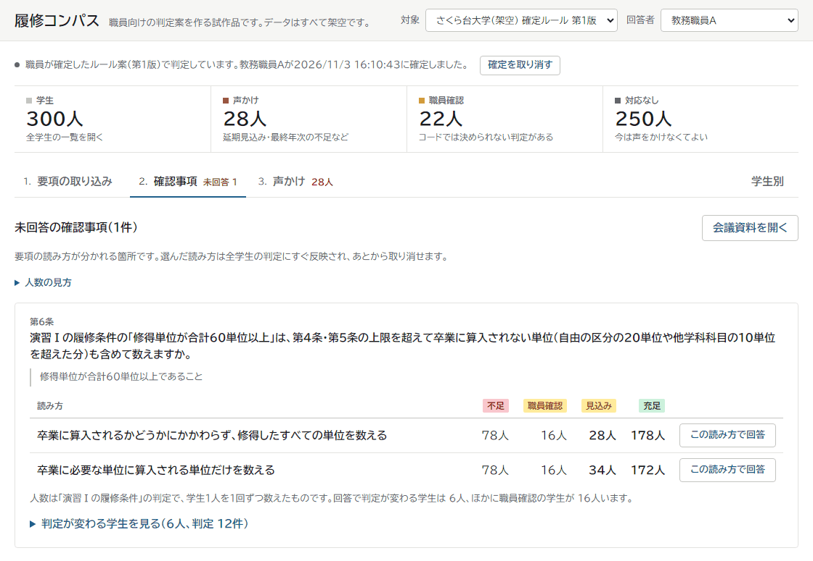
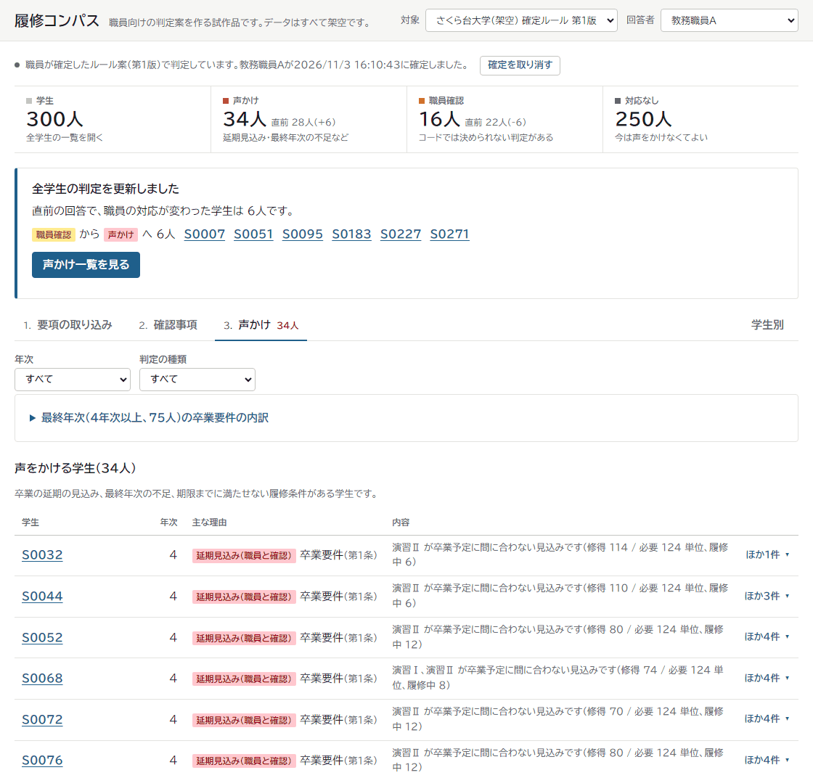
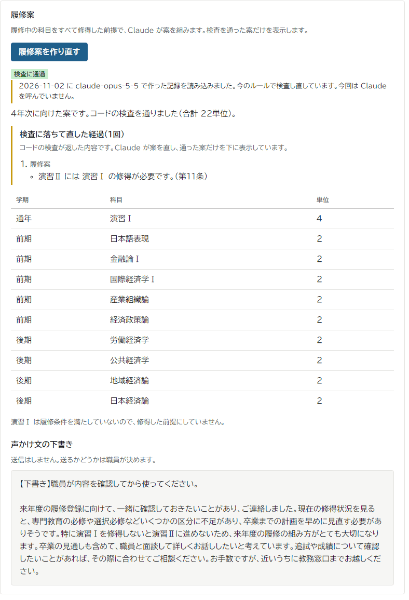

# 履修コンパス

卒業が危ないのに窓口に来ない学生に、大学の教務職員が先に声をかけるためのツールです。履修要項の読み方が分かれる箇所を職員に質問し、その回答を全学生の判定に反映して、声をかける相手と根拠を示します。

学生が使う画面や相談チャットはありません。作り手は大学の教務職員です。

> Built with Claude: Japan 2026 の期間中（2026-11-02〜11-08）に作成しました。**公開デモ: https://ando-00.github.io/rishu-compass/** 。インストールも API キーも要らず、下の[試す手順](#試す手順)をそのまま試せます。

## 何に困っているか

教務職員は、学生が卒業できるかを、履修要項と成績の記録から確かめています。要項には、読み方で学生の結果が変わる文があります。たとえば演習Ⅰの履修条件の「修得単位が合計60単位以上」は、卒業に数えない単位まで60単位に入れるのか、文面からは決まりません。演習Ⅰと演習Ⅱは必修で、演習Ⅱは演習Ⅰを修得しないと履修できないので、演習Ⅰが遅れると卒業も遅れます。

現場では、こうした箇所を職員の経験で補っています。卒業要件の判定は教務システムが行い、結果は学生にも一斉に知らされます。ただ、職員が全学生の結果を1人ずつ見ることはありません。卒業の見込みが立たない学生がいても、誰かに言われない限り、職員から個別に動くことは基本的にありません。そのため、危ない学生に気づけるのはたいてい本人が窓口に来たときで、本当に危ない学生ほど窓口には来ません。声をかけるのが遅れると、最終年次には、残りの履修機会で卒業に必要な単位をそろえられなくなります。卒業できないと分かる学生は、毎年何十人かいます。

架空のさくら台大学（300人）で、下の「試す手順」のとおり、この60単位の条件（第6条）に「卒業に必要な単位に算入される単位だけを数える」と答えると、声かけの対象は28人から34人になります。コードでは決められず「職員確認」になっていた6人が声かけの対象に移ったことが、回答したその場で分かります。

## 画面

職員に質問する箇所です。答える前に、読み方ごとの影響人数が出ます（架空の学生300人）。



回答すると全学生の判定が更新され、職員の対応が変わった6人と、声をかける学生の一覧が出ます。



Claude が組んだ履修案は、コードの検査に落ちて直した経過と一緒に出ます。声かけ文は下書きで、送るかどうかは職員が決めます。



画面は下の「試す手順」6、7、10 のものです。

## Claude に任せること、任せないこと

Claude に判定をさせません。単位の集計、要件の充足、履修案の検査、影響人数の計算は、すべて `engine/` のコードが行います。Claude がするのは次の2つだけです。

- 要項を読んでルール案を作り、読み方が分かれる箇所を職員への質問にする
- 履修案と声かけ文の下書きを作る

Claude の出力は、表示より先にコードが検査します。画面の3か所でそれが分かります。

| 画面 | 文言 | 意味 |
|---|---|---|
| 要項の取り込み | 「職員が確定するまで、この案は判定に使いません。根拠の文が要項にあることは検査しましたが、解釈が正しいことは保証しません」 | ルール案は、根拠の文の実在と検査用ケースをコードで検査し、職員が確定するまで判定に使わない |
| 履修案 | 「検査に落ちて直した経過。コードの検査が返した内容です」 | Claude の案は、先修・上限・時限・配当年次の検査に通るまで画面に出ない |
| 声かけ文の下書き | 「送信はしません。送るかどうかは職員が決めます」 | Claude の下書きは、単位数と卒業の可否を断定する文を検査で止める。語の一覧での検査なので、言い回しによっては通る。送るかは職員が読んで決める。「声かけ」の画面にある定型の下書きの単位数は、`engine/` が判定した値 |

分からないものは自動で「職員確認」に回します。未回答の確認事項に関わる判定、編入や休学などの学生、科目データにない科目を持つ学生がこれに当たります。

## 動かし方

**公開デモ:** https://ando-00.github.io/rishu-compass/

インストールなしで、下の「試す手順」をすべて試せます。手元で動かす版と同じコードをブラウザの中で動かしていて、サーバーはありません。Claude は呼びません。回答や確定はそのタブの中だけに残り、再読み込みすると最初に戻ります。

**手元で動かす場合:** Node.js 24 以上を想定しています（22 でも動きますが、`npm ci` と `npm test` に警告が出ます）。**API キーがなくても、下の手順はすべて試せます。**

```sh
git clone https://github.com/ando-00/rishu-compass.git
cd rishu-compass
git config core.hooksPath .githooks
npm ci
npm run dev
```

初めての `npm run dev` では、手元の DB に表を作ってよいか（`continue?`）を聞かれます。Enter か `y` を押してください。

`git config core.hooksPath .githooks` は、コミットと push の前に API キーの混入を止める検査を有効にします。試すだけなら省けます。

表示された URL（通常は http://localhost:5173 。使用中なら別のポートになります）を開きます。

Windows では、深いフォルダに置くと `npm run dev` が `internal error` で止まることがあります。ローカルの DB のパスが長すぎるためです。短いパスのフォルダで clone してください。

## 試す手順

さくら台大学（架空）の要項で、Claude が作ったルール案を確定し、職員の回答を全学生の判定に反映します。

1. 画面の上の「対象」が「さくら台大学（架空）」であることを確かめます。その下に「作り手が要項を読んで決めた正解ルールで判定しています」と出ています。「要項の取り込み」を開きます。起動直後の人数は、このルールで判定したものです
2. 先に「確認事項」を開きます。未回答が2件（第13条と第6条）あります。これは作り手が要項を読んで決めた正解ルールの質問です。この2件を覚えておきます
3. 「要項の取り込み」に戻り、「記録を読み込む」を押します。実際に Claude で変換した記録が開きます。今回は Claude を呼びません
4. 根拠の文、検査用ケースの結果、職員に確認する箇所を見ます。「職員に確認する箇所」は第6条の1件だけです。Claude は第13条の曖昧さを3回の変換すべてで見逃しました
5. 下の「このルール案を確定する」を押します。職員が確定するまで、案は判定に使いません。確定すると表示が「職員が確定したルール案（第N版）で判定しています」に変わり、以後はこの版で判定します
6. 「確認事項」を開きます。未回答は第6条の1件だけになっています。正解ルールにあった第13条の質問は、Claude が見逃したので、ルール案を確定すると消えます。Claude が見逃した箇所は職員確認に回らないので、職員が要項を読んで確かめる必要があります。確定の欄と「対象」の下の行にも、失格の再履修のルールがないことを出します。第6条の読み方ごとに、判定が変わる学生の人数が出ています
7. 「卒業に必要な単位に算入される単位だけを数える」の行の「この読み方で回答」を押します。全学生の判定が更新され、声かけの人数が増えます
8. 「声かけ」を開くと、理由と根拠の条文を付けた一覧があります。理由には不足の量（修得と必要の単位、未修得の必修科目）が付きます。年次と判定の種類で絞り込めます
9. 一覧の S0095 を開くと、区分別の不足と根拠を見られます
10. 同じ画面の下にある「履修案」の欄で「記録を読み込む」を押します。検査に落ちて直した経過、検査を通った履修案、声かけ文の下書きが出ます。保存した案も今のルールで検査し直しています。2人とも卒業予定の時期までに卒業するのが難しい見込み（延期見込み）なので、案の上に「職員面談に回してください」の印が出ます。この印は Claude ではなくコードが付けます。記録があるのは、手順7で回答したあとの S0007 と S0095 の2人分です

手元で動かした場合、確定と回答は手元の DB（`.wrangler/state`）に残ります。2回目に起動すると、対象は「確定ルール 第N版」になり、第6条は回答済みです。最初からやり直すときは、サーバーを止めて `.wrangler/state` フォルダを消してから `npm run dev` を実行します。

### 判定と対応の見方

判定は、学生ごとに、要件や条件の1つずつに付きます。職員の対応はその判定から決まり、上の手順で出る人数はこの対応の人数です。

| 判定 | 意味 | 職員の対応 |
|---|---|---|
| 充足 | 要件を満たしている | 対応なし |
| 見込み | 履修中の科目を修得すれば満たす | 対応なし |
| 遅れ | 履修条件を判定の時点に満たさず、次の年度以降に認める（認める年次を理由に出す） | 対応なし。その遅れで卒業が間に合わなければ、卒業要件が延期見込みになり声かけ |
| 不足 | 満たしていない | 要件は最終年次（4年次）なら声かけ、それより前は対応なし。履修条件は判定の時点を過ぎていれば声かけ |
| 延期見込み（職員と確認） | 卒業予定までの履修機会では足りない見込み | 声かけ |
| 職員確認 | 未回答の確認事項、特別な状態、ルールの外のことがあり、コードでは決められない | 職員確認。ただし、どの読み方でも対応が要らないと確かめられた学生は対応なし |

声かけは、延期見込みか、最終年次の不足か、履修条件を判定の時点までに満たせない見込みか、判定の時点を過ぎても満たしていない学生に付きます。

かもめ大学（架空）でも、手順1の「対象」を切り替えると試せます。確認事項は11件あり、1問答えただけでは人数が動かないことがあります。上のカードから順に最初の読み方で答えると、7問目で声かけが10人から17人になります。

学生別の画面の上にある「今期の登録の検査」は、今年度の履修中の記録に履修案の検査を掛けた結果です。職員確認の候補を示すもので、声かけと職員確認の人数には足しません。

「見本（動作確認用）」は、ルールの書式と判定を確かめるための小さなデータです。

## API キーを使う場合

要項の変換と履修案の作成を実際に動かすには、Anthropic の API キーが必要です。費用がかかります。要項の変換（3回）は、1校あたり約0.5〜1.4ドルでした。

`.dev.vars.example` を `.dev.vars` にコピーし、次のように書いて `npm run dev` を実行し直します。

```text
ANTHROPIC_API_KEY=お持ちのキー
ALLOW_CLAUDE=true
```

| 機能 | API キーなし | API キーあり |
|---|---|---|
| ルール案の確定、回答の反映、全学生の判定、声かけ一覧、学生の詳細 | 使える | 使える |
| 履修案の検査 | 使える | 使える |
| 要項からルール案を作る | 記録を読み込む | 実際に変換する |
| 履修案と声かけ文の下書きを作る | 2人分の記録を読み込む | 実際に作る |

## 確かめるコマンド

```sh
npm run build
npm test
```

どちらも API キーなしで動きます。テストは Claude を呼びません。

## 評価

架空の2校と、作り手が内容を決めた正解による評価です。実際の大学での精度を示すものではありません。

| 測るもの | さくら台大学 | かもめ大学 |
|---|---|---|
| ルール変換の項目の一致 | 68/68 | 78/88 |
| 曖昧箇所の検出 | 1/2 | 3/11 |
| 仕込んだ曖昧さの検出 | 1/1 | 1/4 |
| 全学生の判定の一致（未回答） | 2689/2700 | 1252/1666 |
| 根拠の文の実在 | 22/22 | 30/30 |

さくら台大学のプロンプトは正解との比較を見て直したので、この一致率は未知の要項での精度を示しません。かもめ大学は調整していません。

2校とも、見逃した曖昧さが残りました。さくら台大学は第13条を3回とも見逃し、全学生の判定2700件のうち11件で、正解では職員確認なのに案では不足（7件）か見込み（4件）になりました。変換の出力形式には、失格した科目の再履修の可否を表す項目がまだありません。そのため、確定したルール案は、失格した科目の再履修を止めずに検査します。かもめ大学は、進級と卒業研究の単位の数え方に「修得した全単位を数える」と答えた場合に、1666件のうち48件で、正解では職員確認なのに案では見込みになりました（未回答では0件）。項目がよく一致していても、見逃しがないとは限りません。Claude が見逃した箇所は職員確認に回らないので、解釈の正しさは職員の確認に依存します。

評価用の10名を作り手の正解と照合すると、最初は区分別の不足単位が 61/63 で一致し、危険な誤りは4件でした。食い違いを作り手が確かめて正解を直し、卒業要件が延期見込みの学生の案には職員面談に回す印をコードで付けるようにしたあとは、63/63、危険な誤り0件です。正解はアプリの答えを見て直したので、独立した数字は最初の照合です（`docs/EVALUATION.md`）。

保存した結果は、Claude を呼ばずに検査し直せます。

```sh
npm run eval:recheck
npm run eval:score
```

`eval:score` は `evals/results/score/` に結果ファイルを1つ書きます。上の表のうち「仕込んだ曖昧さの検出」の行だけは、仕込みの一覧がリポジトリの外にあるので、コマンドでは出ません。

全ての回の結果と結果ファイルの対応は [docs/EVALUATION.md](docs/EVALUATION.md) にあります。

## 開発について

企画と仕様の検討は開始前にリポジトリの外で行いました。架空の要項と判断ルールの文章は、開始前に作った入力データです（一覧は [docs/DATA.md](docs/DATA.md)）。コードと、それ以外のデータ、プロンプトは、すべてイベント期間中に作成しています。

作業の記録と Claude Code の使い方は [docs/PROGRESS.md](docs/PROGRESS.md) にあります。作成者（author）が `Claude <noreply@anthropic.com>` のコミットは、クラウドの Claude Code のセッション（夜間ループを含む）によるものです。どれも作り手が指示して動かしました。このセッションのコミットの時刻は UTC（`+0000`）で記録されています。日本時間はこれに9時間足した時刻です。

## Claude Code の使い方

開発は1人で、Claude Code を中心に進めました。作り手が決めたのは、何を作るか、正解ルールの中身、解釈が分かれる箇所の扱いです。実装、検査、監査は Claude Code に任せ、目的ごとに機能を使い分けました。

| 使ったもの | 何をさせたか | なぜそれを選んだか |
|---|---|---|
| テストを先に書かせる | 判定エンジンを仕様に合わせて作り直すとき、仕様のテスト T01〜T36 を同じコミットで入れさせた。そのあとの直しは、落ちるテストを先に書かせてから実装させた | 単位の判定は1件の誤りが学生の卒業に関わる。何が正しいかを先にコードで固定したかった |
| サブエージェント（監査） | 実装したセッションの見立てを渡さないサブエージェントを、ルール、コード、教務職員役に分けて同時に動かした。対象のコミットに固定した複製で読ませ、指摘は、元のセッションで再現してから記録した（[docs/AUDIT_LOG.md](docs/AUDIT_LOG.md)） | 書いた本人の文脈を持つと、同じ見落としを繰り返す。役を分けると、職員が画面で迷う箇所とコードの誤りを別々に拾える |
| サブエージェント（手計算） | 実装を読ませないサブエージェントに、テストの期待値31件をルールと学生から手で求め直させた（一致29、不一致0、判断できない2） | 期待値が実装から逆算されていないことを確かめたかった |
| サブエージェント（採点） | 作者の見立てを渡さないサブエージェントに、公式の審査基準と提出文だけを渡して10点満点で採点させた。審査員役、数字の事実確認、文章の校正に分け、3回繰り返した。指摘は保存した実行の記録とコードで再現してから採った | 自分の文章の言い過ぎや、初めて読む人に伝わらない箇所は、自分では気づきにくい |
| ランダムな学生でバグ探し | 同梱の学生が全員後期だったので、前期を含む学生をランダムに作らせ、未回答で検査に通った案が回答のあとに不合格にならないかを調べさせた。同梱データでは出ない、前期の学生の履修案の検査の抜けが見つかった（[docs/AUDIT_LOG.md](docs/AUDIT_LOG.md) の R-1） | 手で選んだ例は、作った人の想定の範囲しか通らない |
| 案の洗い出し | 機能の案を作業量と注意点つきで棚卸しさせ（A〜I の9案）、作り手が4案を選んで実装させた（[docs/BACKLOG.md](docs/BACKLOG.md) の H14） | 期間が短いので、何を作るかは人が選びたかった |
| 壊す検査 | コードをわざと壊してテストが落ちるかを確かめさせ、すり抜けた箇所にテストを足させた。最初は90か所のうち7か所がすり抜けた。今は231か所のうち228か所で落ち、残りの3か所は表示だけの箇所（`scripts/mutate.mjs`） | テストが通ることだけでは、テストが誤りを止められるかは分からない |
| フック | SessionStart で検査の準備、PreToolUse で履歴の書き換えやブランチの作成を止め、PostToolUse で push のあとの CI の確認を促し、Stop で終える前に機械検査を回す。git の pre-commit と pre-push で API キーを止める（`.claude/`、`.githooks/`） | 「守ること」を指示で頼むのではなく、コードで止めたかった。フックの判定はテスト106件で確かめている |
| スキルと定期の起動 | 夜間ループの手順をスキルにし（`.claude/skills/night-loop/`）、claude.ai のスケジュールで毎晩クラウドのセッションを起こした。`docs/BACKLOG.md` の「判断不要」の作業だけを1件ずつ進める | 寝ている間も進めたい。一方で、解釈の判断は人がするので、判断が要るものは進めずに記録させた |
| ヘッドレスのブラウザ | README の「試す手順」を、API キーのない新しいクローンで最後まで操作させた（`scripts/e2e-readme.mjs`） | 書いた手順どおりに動くことを、毎回同じ方法で確かめたかった |
| 実際の API を早く呼ぶ | ルール変換は、テストが通った段階で実際の API を呼ばせた | モックのテストでは、スキーマが大きすぎて API に拒まれる問題が見つからなかった（[docs/PROGRESS.md](docs/PROGRESS.md) の「詰まった場面の記録」） |
| 選択肢で質問させる | 正解ルールと監査の判断は、Claude に解釈の案を出させず、選択肢の質問にして作り手が選んだ。Claude は清書だけをした | Claude の出力を Claude の正解で採点すると、評価の意味がなくなる |
| モデルの選択 | 作品の中で呼ぶモデルは、要項の変換も履修案と声かけ文も Claude Opus 5.5 にした（`worker/rule-extraction/claude.ts`、[docs/EVALUATION.md](docs/EVALUATION.md)） | 精度が高く、費用に見合う。Claude Fable 5.1 は使用量の上限にすぐ届き、この用途には性能が余る |
| 複数のセッション | 同じ作業ツリーで、監査の修正、画面、提出の準備を別のセッションに分け、担当のファイルをセッションどうしで確認させた | 期間が短く、並行で進める必要があった。同じファイルを同時に書き換えないための取り決めを作業のルールに入れた（[AGENTS.md](AGENTS.md)） |

## データについて

すべて架空の大学と架空の学生です。実在の大学の情報は使っていません。

## 素材の出典

デモ動画の語りには、VOICEVOX の音声（VOICEVOX:冥鳴ひまり）を使っています。この音声は Claude で作ったものではありません。

## ハッカソンの後

今は試作品で、データはすべて架空です。実際の大学で使うには、次の3つが要ります。

- 学生の記録の取り込み: 教務システムから書き出した成績と履修登録を、このツールが読める形に変える処理。今はありません
- 学内だけで動く環境: 学生の記録を学外へ出さずに置ける場所と、職員だけが使える認証。今は認証がありません
- 要項を改正したときの確認: 新しい要項を貼り、前の確定版とのルールの差分から、判定が変わる学生を確かめる運用。ルールの差分を出す機能はありますが、版どうしで学生の判定を並べる機能はまだありません

最初は、要項を改正した年度の初めに、最終年次の学生だけで試します。職員が今の方法で確かめた結果と、このツールの判定を突き合わせます。うまくいけば、年2回（新年度の履修登録の前と、成績が確定した直後）に広げます。そのたびに未回答の確認事項に答え、声かけの一覧を窓口と学科の担当で分け合います。解釈の正しさは、職員の確認に委ねます。

まずは自分の職場に、この形で試すことを提案します。

## 注意

試作品です。このツールが示すのは職員向けの判定案で、卒業の認定は大学の手続きに残します。解釈の正しさは職員の確認に委ねます。Claude が見逃した曖昧さは残り得ます。

## ライセンス

[MIT](LICENSE)
